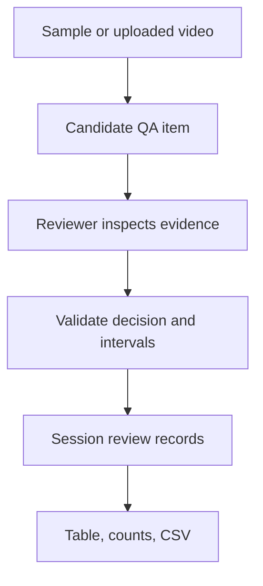

# EvidenceFrame — Complete first-release blueprint

Status: first-release scope set, 15 November 2026. This is an independent portfolio prototype, not a Quantigo AI product or an account of its internal systems.

## 1. Problem and user

Video question–answer datasets can include a wrong proposed answer, ambiguous wording, or an answer unsupported by the video. A human reviewer needs to see the source, mark the evidence, record a defensible decision, and hand off a consistent dataset. Primary user: reviewer. Secondary user: project lead checking review outcomes.

Quantigo AI publicly lists Q&A pair validation/correction, visual question answering, and image/video captioning. The EgoSchema paper describes human curation and temporal evidence for long-form video QA. Those motivate the problem; our prototype's rules and data are our own.

## 2. One complete user journey

1. Open a prepared, clearly labeled sample video and candidate question–answer item.
2. Play and seek through the video.
3. Check whether the question is answerable and the proposed answer is supported.
4. Select one or more evidence intervals (start/end seconds) and an issue label.
5. Decide Approve, Reject, or Needs review; explain why.
6. See the saved review and correct it if needed.
7. Export review rows and a small summary for project handoff.

An interval is a piece of the video that supports or challenges the answer. The numbers must reflect the actual clip. There is no universal 2–8 second interval.

## 3. Data contract

| Field | Meaning | Rule |
| --- | --- | --- |
| item_id | Stable ID for a candidate QA item | Required, unique within sample |
| video_id / filename | Which clip was reviewed | Required |
| question | Question about the clip | Required nonblank text |
| proposed_answer | Answer under review | Required nonblank text |
| evidence_intervals | Start/end seconds, possibly more than one | Each start >= 0; each end > start; within known video duration when available |
| decision | Approve / Reject / Needs review | Required |
| issue_type | Wrong answer / unsupported / ambiguous / temporal issue / other | Required for Reject or Needs review |
| reason | Human-readable explanation | Required |
| reviewer_id | Practice reviewer label | Optional for initial demo |
| reviewed_at | Review timestamp | Captured automatically when saving |

For a small example, a 12-second clip might show a pen placed on a book at seconds 4–7. If the question asks what was placed on the book, 4–7 is an evidence interval. A question requiring events at 5 seconds and 40 seconds needs two intervals.

## 4. Complete first-release boundaries

**Release 1 must ship before it goes on the CV**
- Prepared 45–60 second sample video with documented ownership or reuse permission and at least three candidate items: supported, deliberately wrong, and ambiguous. The sample must be usable without upload.
- Upload option for a visitor's short MP4.
- Video playback, review form, candidate item ID, proposed answer and alternatives, up to two evidence intervals, decision, issue type, and reason.
- Validation of required fields and interval order; duration bounds if reliable duration metadata is available.
- Multiple review rows in the current session, with replace-by-item behavior; export and re-import records so a user can continue later.
- CSV export and simple counts with denominators (e.g., 1 rejected out of 3 reviewed).
- README with setup, sample provenance, limitations, screenshots, GitHub and live demo links.

**Separate future research extensions; not part of this release**
- AI-generated candidate questions, video-model assistance, single-frame-versus-multi-frame experiments, two-reviewer agreement/adjudication, persistent accounts/database.
- The EgoSchema paper's 30-second temporal-certificate criterion is specific to that benchmark. Our short demo will not claim to reproduce EgoSchema or certify long-term understanding.

## 5. System and data flow

Python + Streamlit renders the interface and runs the validation. `st.session_state` holds temporary review rows for one browser session. Python's CSV tools produce the export. GitHub stores code; Streamlit Community Cloud is the intended public host. There is no hosted database in Release 1. Export/re-import provides user-controlled continuity; do not describe session state as permanent storage.

## 6. Demo data and evaluation

Prefer a self-recorded, non-sensitive clip showing a sequence of visible actions. An AI-generated clip is an optional second, clearly labeled synthetic stress case. Do not publish someone else's clip without permission. Create candidate items manually and mark any deliberately seeded mistakes as such.

A tiny pilot should report raw counts, examples of caught seeded errors, and failure cases. It must not claim general accuracy, time savings, or reviewer agreement without an appropriate comparison and sample.

## 7. Build order and gates

1. **Existing prototype:** upload, free-text QA, single interval, decision, session rows, CSV. It proves the basic data path, but cannot judge truth.
2. Add reason and issue type. Test empty and valid cases.
3. Define sample data, sample clip, answer alternatives, and stable item IDs. Make the app usable immediately on opening.
4. Support multiple evidence intervals and enforce review rules.
5. Add replace-by-item behavior, CSV import/export, and a concise summary; verify CSV against on-screen records.
6. Document data provenance, limitations, setup, and screenshots.
7. Deploy, open the public demo in a signed-out browser, test an end-to-end review, and add links to README/CV.

**Definition of done:** A stranger can open the public link, review a prepared candidate without supplying their own clip, explain the evidence, export the result, and understand the code and limitations from the README.

## 8. Working decisions

- Use a self-recorded non-sensitive action sequence as the primary sample. If that proves impractical, use a clearly identified synthetic clip with publication rights.
- Include proposed answer and alternatives in the prepared candidate items; the current free-text form is only a prototype.
- Require issue type and reason for a rejected or uncertain item; a corrected answer can be entered when available.
- Complete this bounded release, including a signed-out demo test, before listing EvidenceFrame on a CV.

## Sources

- [Quantigo AI Gen AI solutions](https://www.quantigo.ai/solutions/gen-ai)
- [EgoSchema paper](https://papers.nips.cc/paper_files/paper/2023/file/90ce332aff156b910b002ce4e6880dec-Paper-Datasets_and_Benchmarks.pdf)
